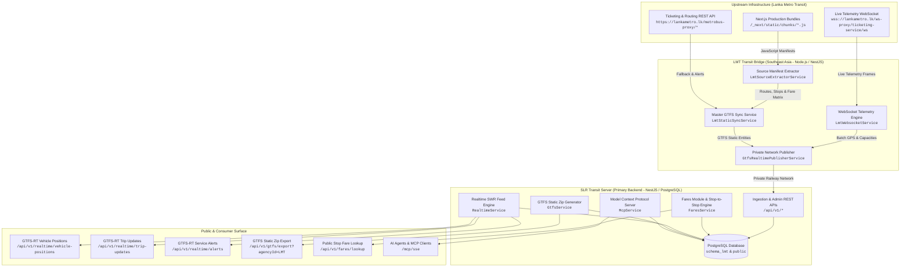

# 01. System Architecture & End-to-End Design

## 1. Executive Summary & Mission
The **Lanka Metro Transit (LMT) Bridge & SLR Transit Platform** is an enterprise-grade transit data ingestion, enrichment, and publication engine. It bridges proprietary, undocumented, and closed-loop operational technology (OT) from Sri Lanka's premium bus network (**Lanka Metro Transit Pvt Ltd / Eimsky SmartMetro**) into the open, globally standardized **GTFS (General Transit Feed Specification) Static** and **GTFS-Realtime (GTFS-RT v2.0)** specifications.

Through this platform, live telemetry from commercial buses, official stop-to-stop fare tariffs, routes, platforms, trip timetables, service advisories, and real-time passenger crowding metrics are continuously ingested, validated, geofenced, transformed, and exposed to passenger transit apps (Google Maps, Apple Maps, Transit App) and multi-modal routing algorithms (OpenTripPlanner).

---

## 2. High-Level Component Topology

---

## 3. Core Subsystems

### A. `lmt-transit-bridge`
* **Role**: Operational bridge and upstream integration agent.
* **Technology**: NestJS, TypeScript, `ws`, `axios`, `rxjs`.
* **Deployment**: Hosted on Railway in the **Southeast Asia (`asia-southeast1`)** region to bypass Cloudflare geo-blocking enforced on Western/US IP addresses.
* **Primary Responsibilities**:
  1. Maintain persistent, zero-auth WebSocket connection to `wss://lankametro.lk/ws-proxy/ticketing-service/ws`.
  2. Parse, sanitize, and validate incoming `gps_update` frames.
  3. Compute passenger seat statistics and GTFS occupancy status enums.
  4. Dynamically discover and parse Next.js JavaScript chunks to extract routes, platform stops, and the exact 2,575 stop-to-stop fare matrix without brittle hardcoding.
  5. Publish telemetry and schedule static data via private internal network to `slr-transit-server`.

### B. `slr-transit-server`
* **Role**: Central transit authority database, GTFS compilation pipeline, and API server.
* **Technology**: NestJS, Prisma ORM, PostgreSQL (multi-schema), `gtfs-realtime-bindings`, `jszip`, `@modelcontextprotocol/sdk`.
* **Primary Responsibilities**:
  1. Manage dual PostgreSQL schemas: `schema_lmt` (isolated LMT operational tables) and `public` (canonical national transit tables).
  2. Implement Stale-While-Revalidate (SWR) in-memory cache for ultra-fast Protobuf feed generation (<15ms latency).
  3. Generate official GTFS Static Zip packages conforming strictly to MobilityData and Transitland specification validators.
  4. Serve standard GTFS-Realtime v2.0 Protocol Buffer binary feeds (`VehiclePositions`, `TripUpdates`, `ServiceAlerts`).
  5. Host the public fare calculation engine (`/api/v1/fares/lookup`).
  6. Provide Model Context Protocol (MCP) streamable HTTP server for AI agent querying.

---

## 4. Key Metrics & Capacity
* **Corridors Covered**: 7 Express & Arterial Corridors (`CM01` to `CM08`).
* **Platform Stops**: 220 authentic GPS-located stops with Sinhala, Tamil, and English trilingual naming.
* **Fare Rules**: 2,575 exact stop-to-stop Origin-Destination fare rules.
* **Live Commercial Fleet**: 65–75 active buses tracked continuously during operational hours (04:30 to 23:30 IST).
* **Telemetry Cadence**: 5,000ms (5 seconds) per vehicle position update.
