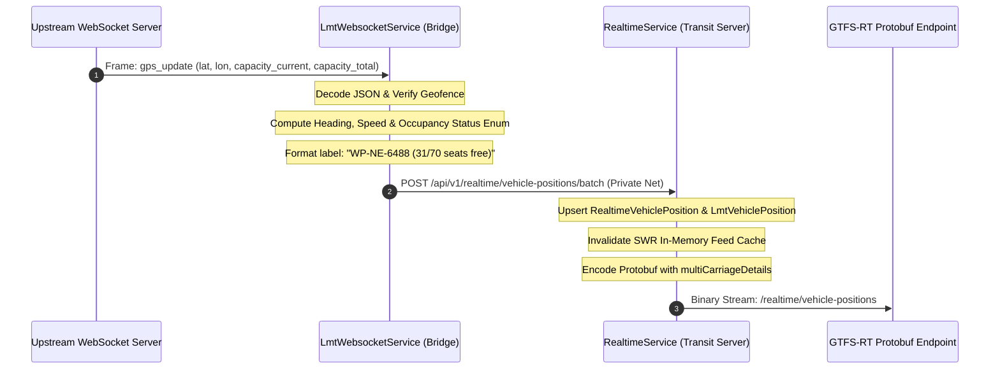

# 03. Telemetry Pipeline, Live Streaming & Seat Occupancy

## 1. The Real-Time Telemetry Pipeline Overview

The telemetry streaming pipeline ingests high-frequency GPS and vehicle passenger metrics from upstream, enriches the data, calculates international GTFS-RT occupancy statuses, and forwards batches across Railway's private network into the central transit server.



---

## 2. WebSocket Supervision & Lifecycle Management

Implemented in [`LmtWebsocketService`](file:///c:/Users/SGSey/WebstormProjects/lmt-transit-bridge/src/lmt/lmt-websocket.service.ts), the connection follows an autonomous, resilient supervision pattern:

### A. Lifecycle State Machine
* **`CONNECTING`**: Establishes TLS socket to `wss://lankametro.lk/ws-proxy/ticketing-service/ws`.
* **`CONNECTED`**: Sets `isUpstreamHealthy = true`, resets backoff multipliers, logs active connection.
* **`PONG / HEARTBEAT`**: Responds to WebSocket ping frames, watches message arrival timestamps.
* **`DISCONNECTED / RECONNECT`**: On abnormal closure or error, triggers exponential backoff (starting at 2s up to max 30s) and attempts seamless reconnection.

### B. Fleet Memory Ledger & Inactivity Eviction
Vehicles are tracked in an in-memory `Map<string, ActiveBus>`:
* **Key**: Registration number / `bus_id` (e.g. `WP-NE-6488`).
* **Value**: Coordinate history, previous timestamp, computed heading, current trip ID.
* **Stale Eviction**: Buses that have not transmitted GPS data for **> 45 minutes** (e.g., parked in depot, off-shift) are automatically pruned to prevent ghost vehicles from lingering in passenger transit feeds.

---

## 3. Passenger Seat Capacity & Occupancy Status Engine

Upstream broadcasts raw sensor counts for every bus:
* `current_capacity`: Number of passengers onboard (e.g., `39`).
* `total_capacity`: Maximum certified capacity (e.g., `70`).

### A. Percentage Calculation
```typescript
const occupancyPercentage = (total_capacity > 0)
  ? Math.round((current_capacity / total_capacity) * 100)
  : undefined;
```

### B. GTFS-Realtime `OccupancyStatus` Enum Mapping
Standard GTFS-RT v2.0 defines an enum for occupancy. The platform dynamically maps percentages to standard enum values:

| Occupancy Percentage | GTFS-RT Enum Value | Display Meaning |
| :--- | :--- | :--- |
| `0%` | `EMPTY` (0) | Bus is completely empty. |
| `1% - 50%` | `MANY_SEATS_AVAILABLE` (1) | Low crowding, plentiful seating. |
| `51% - 85%` | `FEW_SEATS_AVAILABLE` (2) | High seating occupancy, few seats remain. |
| `86% - 100%` | `STANDING_ROOM_ONLY` (3) | All seats occupied, standing room only. |
| `> 100%` | `FULL` (5) | Bus at maximum physical capacity. |

### C. Human-Readable Vehicle Label Enrichment
In addition to the raw enum and percentage, the platform enriches `VehicleDescriptor.label`:
```typescript
const availableSeats = Math.max(0, total_capacity - current_capacity);
const vehicleLabel = `${regNum} (${availableSeats}/${total_capacity} seats free)`;
```
* **Example**: `"WP-NE-6488 (31/70 seats free)"`.
* When displayed in consumer transit apps (such as Transit App or Apple Maps), passengers immediately see exact seat availability without needing specialized UI decoders.

---

## 4. Multi-Carriage Details (GTFS-RT 2.0+ Spec)

For advanced transit clients that support carriage-level occupancy, each vehicle entity encodes a `CarriageDetails` entry:

```typescript
const carriageDetails = (pos.capacity_total != null && pos.capacity_total > 0)
  ? [
      new transit_realtime.VehiclePosition.CarriageDetails({
        id: '1',
        label: `${pos.capacity_current ?? 0}/${pos.capacity_total} occupied`,
        occupancyStatus: occupancyStatusEnum,
        occupancyPercentage: pos.occupancy_percentage ? Math.round(pos.occupancy_percentage) : undefined,
        carriageSequence: 1,
      }),
    ]
  : undefined;
```

---

## 5. Private Network Batch Publication

To minimize HTTP overhead and eliminate public internet exposure between our own microservices:
1. **Network Layer**: Published via Railway Private Network (`http://slr-transit-server.railway.internal:8080/api/v1/realtime/vehicle-positions/batch`).
2. **Chunking**: Outgoing updates are chunked in batches of 50 vehicles to prevent HTTP payload truncation or gateway timeouts.
3. **Authentication**: Secured via internal bearer token and `x-api-key` validation.
